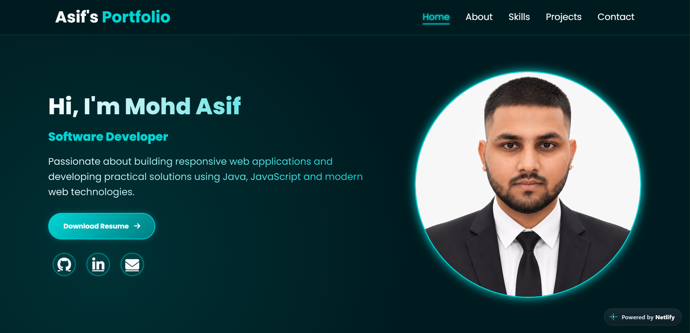
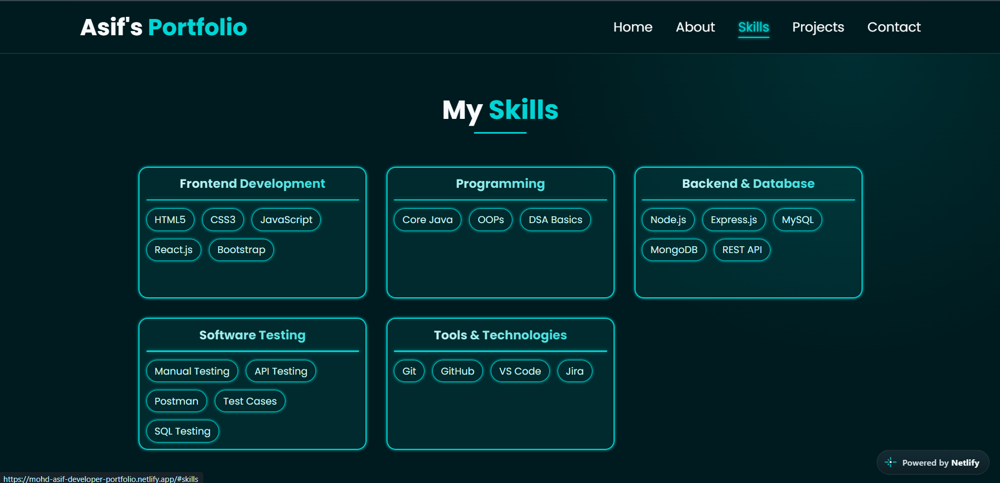
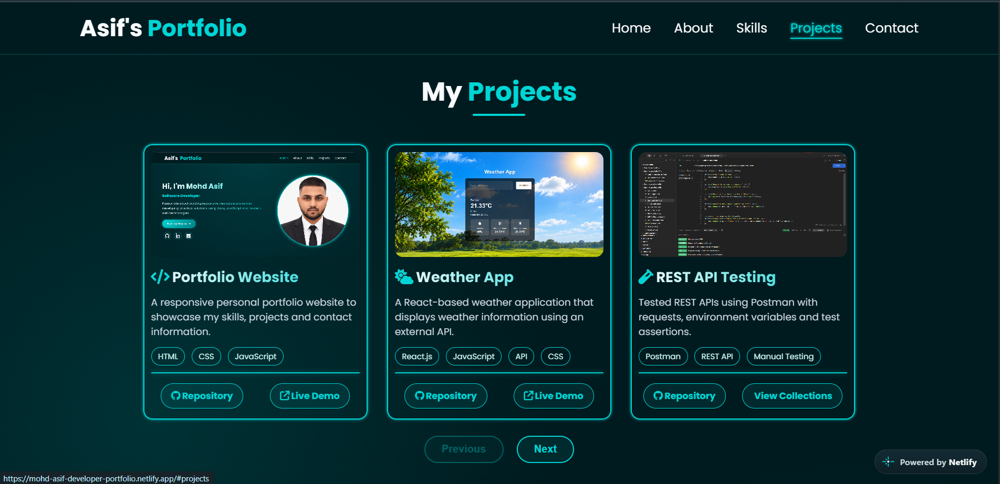

# Asif Developer Portfolio

A personal developer portfolio website showcasing my technical skills, projects, education, and professional background.

## Live Demo

[Visit My Portfolio](https://mohd-asif-developer-portfolio.netlify.app/)

## Portfolio Preview

<table>
  <tr>
    <td align="center"><b>Home Section</b></td>
    <td align="center"><b>Skills Section</b></td>
    <td align="center"><b>Projects Section</b></td>
  </tr>
  <tr>
    <td></td>
    <td></td>
    <td></td>
  </tr>
</table>

## About the Project

This is my personal portfolio website, designed and developed to present my skills, projects, and journey as a developer.

The website provides an overview of my technical knowledge, academic background, and practical projects in web development and software testing.

## Features

- Responsive design for desktop, tablet, and mobile devices
- About Me section
- Education and technical skills
- Project showcase with GitHub and Live Demo links
- Social media profile links
- Contact section
- Smooth navigation and interactive elements

## Technologies Used

- HTML5
- CSS3
- JavaScript
- Font Awesome

## Project Structure

```text
Asif-Developer-Portfolio/
│
├── images/
│   ├── API-Testing.png
│   ├── E-Commerce.png
│   ├── SQL.png
│   ├── weather.png
│   ├── portfolio-home.png
│   ├── portfolio-skills.png
│   ├── portfolio-projects.png
│   └── profile images
│
├── index.html
├── style.css
├── script.js
└── README.md
```

## Run Locally

1. Clone the repository:

```bash
git clone https://github.com/MohdAsif63/Asif-Developer-Portfolio.git
```

2. Open the project folder:

```bash
cd Asif-Developer-Portfolio
```

3. Open `index.html` in your browser.

No additional dependencies or build tools are required.

## Author

**Mohd Asif**

- GitHub: [MohdAsif63](https://github.com/MohdAsif63)
- LinkedIn: [Mohd Asif](https://www.linkedin.com/in/mohdasif-developer)
- Email: mohdasif639444@gmail.com

---

⭐ If you like this project, feel free to explore the repository!
